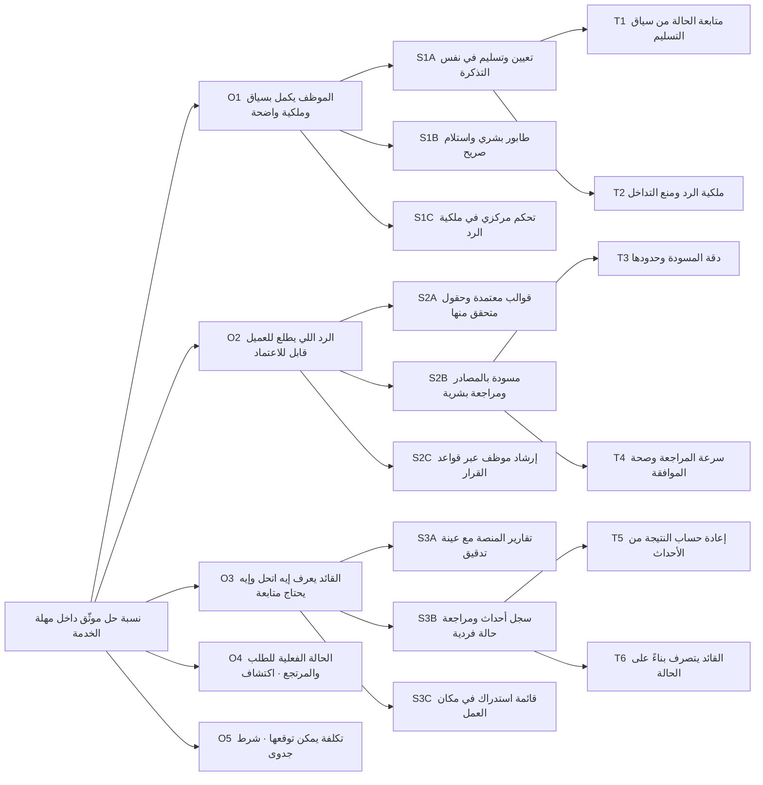

# Opportunity Solution Tree — دعم ما بعد الشراء لمتجر Shopify

مراجعة 18 نوفمبر 2026. الشجرة مسودة اكتشاف مبنية على وصف الشغل، ومتطلبات المشروع، ومقارنة البدائل، وتجارب مستخدمين منشورة. الإعلان يؤكد إن Phase 1 مسودات بموافقة بشرية، وPhase 2 رد تلقائي على مواضيع بسيطة، وPhase 3 توسّع حسب النتائج. انتشار المشاكل في فريق العميل وخط الأساس وصلاحيات الحسابات لسه محتاجين دليل من العميل. [وصف الشغل](./job%20description.txt) · [Requirements and Questions](./requirements-and-questions.md) · [Competitive research](./competitive-research.md) · [Voice-of-Customer Snapshot](./voice-of-customer-snapshot.md)

## 1. نتيجة واحدة قابلة للقياس

**النتيجة المقترحة هي رفع نسبة محادثات الدعم بالإنجليزي داخل النطاق اللي بتوصل لحل متحقق منه في مهلة الخدمة المتفق عليها.** النسبة تشمل المسار البشري الحالي، والرد البشري المعتمد على مسودة في Phase 1، والرد الآلي على المواضيع المسموحة بعد اعتماد Phase 2. فصل المسارات داخل التقرير يخلّي التحسين يتقارن على نفس موضوع وقناة، ويبيّن لو الأتمتة غيّرت تركيب العينة.

| الجزء | التعريف المقترح للمراجعة مع قائد الدعم ومسؤول التقارير |
|---|---|
| المقام | كل محادثة واردة فريدة في القنوات والمواضيع المعتمدة داخل فترة الدخول، بعد اكتمال مدة الرصد. يبدأ الزمن من أول رسالة واردة مؤهلة. تفضل الحالات المحوّلة أو اللي وقف فيها الرد أو دليل حلها ناقص في نفس المقام. أسباب الاستبعاد زي الرسائل التجريبية أو المكررة تتسجل بقاعدة معلنة قبل المقارنة. |
| البسط | المحادثات في نفس المجموعة اللي ليها حدث حل موثّق داخل المهلة W ومرت عليها نافذة متابعة R من غير رجوع لنفس المشكلة. أمثلة الأدلة حسب الموضوع هي تأكيد صريح متعلق بنتيجة السؤال، أو مراجعة إجابة كاملة طبقًا لقاعدة متفق عليها، أو معرّف وحالة للإجراء المطلوب في نظامه المرجعي. قاعدة الإغلاق الموضوعية لكل موضوع محتاجة اعتماد في Q-022 وQ-025. |
| الحالات الحدّية | السكوت أو الشكر العام أو وسم Done لوحده يسيب النتيجة غير متحققة. لو الحالة رجعت لنفس المشكلة داخل R، يُراجع آخر حل موثّق وميعاده. لو ما اتحلتش تاني داخل W تخرج من البسط. الموضوع الجديد المستقل يتبع قاعدة الربط اللي يعتمدها الفريق. فترة الرصد تكتمل عند W + R من البداية. |
| خط الأساس والهدف | ابدأ بفترة ممثلة من الدعم الحالي بنفس القواعد والفلاتر، وأظهر العدد وراء كل نسبة وتوزيع الحالات حسب القناة والموضوع. حجم العينة، وضع ساعات العمل، W، R، خط الأساس والهدف الرقمي محتاجين اعتماد. القنوات والمواضيع في Q-001/Q-002، تعريف الزمن والحل في Q-021/Q-022/Q-025، الفلاتر في Q-027/Q-028/Q-040، وقرار المرحلة والخط الأساسي في Q-003/Q-034/Q-035. |

طريقة الحساب هي عدد المحادثات اللي استوفت البسط ÷ عدد المحادثات المؤهلة بعد اكتمال الرصد × 100. تاريخ أول رد المؤهل بيتبع الإرسال الفعلي وقاعدة Q-021. اقترح إظهار مرسل الرد البشري وعلامة AI-assisted منفصلة في Phase 1. لو مصدر الأحداث نفسه فقد جزء من المحادثات الداخلة، تُعلّم نتيجة الفترة ناقصة لحد ما نقدر نراجع التغطية. فصل المؤشر عن الفوترة مهم لأن Re:amaze بيوثق إغلاقًا آليًا حسب الحالة، وFin عنده تعريفات مختلفة للنتيجة المدفوعة ومعدل الحل. [Re:amaze Conversation States](https://support.reamaze.com/kb/everything-about-conversations/understanding-conversation-states) · [تحديث مؤشرات Fin](https://www.intercom.com/help/en/articles/15599377-update-to-fin-performance-metrics) · [Fin Outcomes](https://fin.ai/help/en/articles/13975800-fin-pricing-outcomes)

**شروط توسّع مقترحة.** اعمل القرار على دليل موافقة قبل الرد في Phase 1، وتسليم سليم للحالات الحساسة، ودقة الرد ومصدره، وخصوصية بيانات الطلب، ومراجعة CSAT وإعادة التواصل والتكلفة جنب النتيجة الرئيسية. تفاصيل القواعد وعتبات الانتقال من صاحب القرار. متوسط أول رد أو ارتفاع عدد تذاكر Done ممكن يساعدوا في التشخيص، ومعدل الحل الموثّق خلال المهلة هو رأس الشجرة. [REQ-003، REQ-006–021، REQ-027 وأسئلة القبول](./requirements-and-questions.md)

## 2. الفرص وترتيبها

ترتيب نوعي حسب صلة الحاجة بالنتيجة والمرحلة الأولى، وشدة أثر الخلل على العميل أو الموظف، وقوة الدليل المباشر واتساقه. أهمية كل حاجة عند فريق العميل ومستوى رضاه الحالي لسه غير مقاسين. لو العميل قاسهم لكل فرصة، ساعتها ينفع نحسب Importance × (1 − Satisfaction) بعد توحيد المقياسين على 0–1. صياغات صوت المستخدم في الجدول تلخيص للمعنى. أرقام E راجعة لسجل الأدلة الأصلي. [سجل الأدلة والفرضيات](./voice-of-customer-snapshot.md) · [Teresa Torres، توثيق الفرص](https://www.producttalk.org/sourcing-opportunities/)

| الترتيب | صوت المستخدم | الدليل وسبب الترتيب | الأسئلة اللي تغيّر الترتيب أو الاختيار |
|---|---|---|---|
| **O1 · أولوية 1** | **عميل وموظف.** لما أطلب موظف، عايزه يكمل من اللي قلته ويكون واضح مين هيرد. | طلب مباشر في REQ-006–013. فيه دلائل من حالات تكرار السؤال أو طلب الموظف E02/E05، ومن بلاغ بريد عن رد آلي وصل بعد رد موظف E01. رصد سلوك التسليم عند العميل محتاج أمثلة، بالذات محادثة من رسالة أو رسالتين. [Zendesk على Reddit](https://www.reddit.com/r/Zendesk/comments/1ufp7xq/help_with_advanced_ai_agent_for_email/) · [Fin Community](https://community.intercom.com/train-fin-94/how-to-deal-with-customers-saying-no-to-fins-question-of-whether-it-answered-their-question-14715) | Q-001، Q-009–015، Q-036 |
| **O2 · أولوية 2** | **عميل وموظف.** عايز إجابة أقدر أتصرف على أساسها. كموظف عايز أعرف أساسها قبل ما توصل للعميل. | شرط صريح في REQ-001 وREQ-014–016. حالات E06–08 فيها تصحيح وردود ضعيفة أو رغبة في المراجعة. E09–10 وE13 فيها تجارب كويسة لو أنواع الأسئلة والمعرفة محددة. ده يدعم اختبار المسودات على أسئلة بعينها وقياس تكلفة مراجعتها. [تجربة تصحيح سياسة وشحن في Gorgias](https://www.reddit.com/r/CustomerService/comments/1pdrg2q/is_there_a_gorgias_alternative_with_ai_that/) · [تجارب متاجر Yuma](https://apps.shopify.com/yuma/reviews) | Q-002، Q-007–008، Q-011، Q-017–019 |
| **O3 · أولوية 3** | **قائد الدعم.** عايز أعرف أنهي حالة اتحلت وأنهي واحدة محتاجة متابعة قبل ما أفوّت العميل أو أوسع الأتمتة. | REQ-017–026 يطلبوا النتائج والفلاتر وفتح الحالة. E04/E08/E20 فيها اختلاف بين الإغلاق أو المؤشر والمراجعة الفعلية. E23–25 تحذّر من فقد أو تكرار في مصادر تصدير محددة. الأثر المباشر هو معرفة مين محتاج استدراك وتحديد أثر التغيير بعده. [Fin Community](https://community.intercom.com/analyze-fin-93/anyone-else-feel-like-fin-s-analytics-are-a-black-box-14051?fid=93&tid=14051) · [Zendesk AI-only tickets](https://support.zendesk.com/hc/en-us/articles/9204149016346-Understanding-AI-agent-tickets-for-AI-agent-only-conversations) · [Airbyte GitHub](https://github.com/airbytehq/airbyte/issues/80326) | Q-021–029، Q-032، Q-034–035، Q-040 |
| **O4 · اكتشاف موازي** | **عميل وموظف.** في حالة طلبي أو مرتجعي، عايز أعرف إيه اللي حصل فعلًا وإيه اللي لسه عليّ أو على الفريق. | REQ-004/005 مؤكدين في الوصف. E14–18 يوضحوا فرقًا بين ظهور الربط ووصول الخدمة، وبين تحديث الشحنة ووصول الإشعار، وبين الحالات في أدوات المرتجع والمخزون. حجم الألم والإجراء المقصود عند العميل مفتوحين. قرار الكتابة مربوط بالخطوة المطلوبة وسجلها. [بلاغ شحن Shopify على Reddit](https://www.reddit.com/r/shopify/comments/1xnmaaj/shopifys_native_delivered_emails_stopped_sending/) · [تجارب CWILL Returns](https://apps.shopify.com/parcel-panel-returns-exchanges/reviews) · [بلاغ ERPNext مجاور](https://github.com/frappe/ecommerce_integrations/issues/397) | Q-004–006، Q-016–017، Q-032، Q-037–038 |
| **O5 · شرط جدوى** | **مسؤول التشغيل.** عايز أعرف تكلفة خدمة الحالات على الحجم الفعلي، وإيه اللي يحصل وقت ما الحصة تخلص. | E22/E26–30 فيه اعتراضات وتجارب شراء أو تفاوض. ده يحدد جدوى خيار الشراء والتوسّع لما العميل يحدد حجم الحالات وتكلفة الحل المقبولة. عقد وتسعير كل حالة لهم سياق منفصل. [رواية عميل Intercom على X](https://x.com/jkeesh/status/2011822715909652691) · [قواعد فوترة Gorgias](https://docs.gorgias.com/en-US/how-youre-billed-for-using-gorgias-199385) · [فوترة Re:amaze](https://support.reamaze.com/kb/using-the-ai-agent/how-ai-agent-resolutions-are-counted-and-billed) | Q-025، Q-032، Q-034–035 |

لو أمثلة العميل أظهرت إن تعارض حالة الطلب أو المرتجع هو أكتر سبب لفوات مهلة الحل، نرفع O4 في الترتيب بعد تعريف الإجراء ومصدره. لو تسليم المحادثة مستقر في الحساب الحالي، نرجّح تثبيت الضوابط الموجودة ونقيس مجهود مراجعة الرد اللي ممكن يقل في O2. الأولويات دي فرضيات قرار قابلة للتعديل.

## 3. الشجرة

العقدة الأولى هي النتيجة. تحت كل فرصة ذات أولوية ثلاثة حلول مقترحة. فرّعنا تجارب التحقق من الحل اللي يستحق يتجرب الأول. تفاصيل الحلول والتجارب بالمعرّفات نفسها تحت الرسم. [طريقة بناء OST](https://www.producttalk.org/glossary-discovery-opportunity-solution-tree/)

## 4. حلول مرشحة من زوايا المنتج والتصميم والهندسة

الحلول في مرحلة اقتراح. كل مسار تسليم محتاج يحقق نص التحويل كاملًا من أول رسالة، وPhase 1 فيها موافقة بشرية قبل الإرسال. اختلاف الحلول في طريقة الوصول لنفس الحاجة. زوايا المنتج والتصميم والهندسة نقاط لورشة الفريق.

| الفرصة | البدائل | ما يتغيّر في سير العمل |
|---|---|---|
| O1 | **S1A · أول اختبار · المنتج.** تحويل بقواعد في Re:amaze وتسليم جوه نفس التذكرة. | سبب التحويل يحدّد الجهة، والسجل الأصلي يفضل متاح، وملاحظة داخلية فيها ملخص حتى لو رسالة واحدة، مع إثبات الموظف أو الطابور المسؤول. ابدأ بالإمكانات الأصلية. تكميل ملاحظة قصيرة ممكن بالتكامل لو لزم بعد التحقق من الخصوصية والملكية على القناة. [الملاحظات](https://www.reamaze.com/api/post_messages) · [التعيين](https://www.reamaze.com/api/put_conversations) |
| O1 | **S1B · التصميم.** طابور تحويل مع خطوة استلام صريحة وقاعدة مناوبة. | الموظف يرى من حالة واحدة مين في انتظار الاستلام، والسبب والملخص والسجل، ويمسك التذكرة بإجراء واحد. لو انتهت مهلة قبول أو مفيش مناوبة، الحالة تتحول للجهة البديلة المعتمدة. يقيس أثر خطوة الاستلام الإضافية على الوقت قبل ما نختارها. [حالات Re:amaze](https://support.reamaze.com/kb/everything-about-conversations/understanding-conversation-states) |
| O1 | **S1C · الهندسة.** تحكم مركزي بملكية الرد مع تأكيد الوصول للموظف. | ينتقل حق الرد عند التحويل، والرد المؤجّل يتراجع قبل الإرسال، ومع إعادة الفتح يبقى المالك حسب القاعدة المعتمدة. المسار ممكن يتقيّم لو قناة محددة فيها مصدر إرسال مستقل أو تسليم من غير حالة تأكيد. تكلفة التكامل والصيانة جزء من المقارنة. [سلوك إعادة الفتح](https://support.reamaze.com/kb/everything-about-conversations/understanding-conversation-states) |
| O2 | **S2A · المنتج.** قوالب معتمدة لأسئلة محددة وحقول طلب مسموحة بعد التحقق. | أسرع قاعدة مقارنة للأسئلة الثابتة. الموظف يختار سياق القالب ويوافق على الرسالة. القوالب تنفع كمسار خدمة في الحالات اللي سياسة المتجر تغطيها مباشرة. [قوالب Re:amaze](https://support.reamaze.com/kb/automation/ai-conversations) |
| O2 | **S2B · أول اختبار · التصميم.** مسودة داخلية بأدلة من مصدر معتمد ومراجعة بشرية في التذكرة. | الموظف يقدر يتتبع الجملة المؤثرة للمصدر المعتمد وإصداره أو قراءة الطلب المصرح بها ويقبل أو يعدل أو يرفض. سياسة متضاربة أو قديمة أو هوية غير متحققة توقف اقتراح الرد القابل للإرسال وتعرض نقصًا محددًا أو مسار التحويل المناسب. الرسالة المرسلة مرتبطة بنسخة وافق عليها موظف. [مصادر Re:amaze](https://support.reamaze.com/kb/using-the-ai-agent/understanding-where-your-ai-agent-gets-its-answers) · [Shopify Protected Customer Data](https://shopify.dev/docs/apps/launch/protected-customer-data) |
| O2 | **S2C · الهندسة.** مسار قرار بسيط للموظف في الحالات اللي محتاجة حكم أو تحقق. | قواعد العميل تبرز السؤال الباقي أو الإجراء المسموح ودليله، والموظف يصيغ الرد بنفسه. طريقة لتقليل التصحيح في الحالات المتغيرة أو تعارض مصدرين. تغطية المسودات المطلوبة تستمر للأسئلة المؤهلة مع الخيار الرئيسي. |
| O3 | **S3A · المنتج.** تقارير Re:amaze الموجودة مع وسوم متفق عليها وعينة تدقيق دورية. | أقل وقت إعداد لو البيانات الأصلية تكفي. قائد الدعم يراجع عينة من الوسم والسبب ويفتح التذكرة من تقرير أو رابط. نتحقق إن نقص البيانات مش بيغيّر المقام. [Re:amaze Chatbot Reporting](https://support.reamaze.com/kb/everything-about-reporting/chatbot-reporting) |
| O3 | **S3B · أول اختبار · الهندسة.** سجل أحداث بسيط للتحقق على مستوى الحالة وعرض سبب الاحتساب. | اربط الردود المؤهلة وأوقاتها ومرسليها، واستخدام المسودة، والتحويل، وحالة الحل، وإعادة الفتح بمعرّف تذكرة. افصل حل متحقق، حالة محتاجة مراجعة، نتيجة مفوترة، وحالة لسه في وقت الرصد. القائد يقدر يراجع الرقم ويرجع للحالة بصلاحياته. ملف أحداث تجريبي أو تصدير منقح كفاية لاختبار الفكرة قبل تقدير أي لوحة. [تعريف نتائج Fin](https://fin.ai/help/en/articles/13975800-fin-pricing-outcomes) · [Re:amaze GET Messages](https://www.reamaze.com/api/get_messages) |
| O3 | **S3C · التصميم.** قائمة استدراك للي رجع بعد الإغلاق أو خرج بعد رد غير مفيد. | القائد يراجع حالات مختارة ويعيّن متابعة أو طلب تحديث معرفة في مكان شغل الفريق. مناسبة لو المشكلة الأساسية استدراك الحالة أثناء يوم العمل، وتستخدم التعريف المعتمد للقياس على مستوى المجموعة. [متابعة CSAT في مجتمع Fin](https://community.intercom.com/ideas/workflows-to-re-open-bad-fin-csat-10195) |

**ترتيب عرض خيارات التنفيذ.** جرّب الحالات نفسها أولًا في Re:amaze، وقارن Yuma فوق Re:amaze على نفس القناة ونفس دليل الموافقة والملخص وملكية الرد لو فيه فجوة. Gorgias أو Fin أو Zendesk يدخلوا مقارنة اختيار منصة لما العميل يفتح قرار الترحيل. توفر التكامل أو أداة Suggest a Response دليل عام، وتفعيل المراجعة قبل كل إرسال والملخص القصير وقراءة الأحداث يحتاجوا عرض على التكوين المتاح. [مسار المقارنة الكامل](./competitive-research.md) · [Yuma for Re:amaze](https://yuma.ai/integrations/reamaze) · [Re:amaze Suggest a Response](https://support.reamaze.com/kb/automation/ai-conversations)

## 5. تجارب تحقق مقترحة

العينات والعتبات تحت أدوات لاتخاذ قرار اكتشاف. حجمها صغير ونتيجتها تخص أمثلتها، واعتماد الانتقال للرد التلقائي يرجع لـQ-003/Q-034/Q-035. التجارب دي تصميمات على الورق. التنفيذ، استخدام بيانات عميل، أي كتابة أو إرسال على حساب عميل، وتفعيل اشتراك يتطلبوا نطاق وصلاحيات منفصلة. خَلّي الاختبارات الأولى على حالات مصطنعة أو عينات منزوعة الهوية بعد الموافقة، وبحضور قائد الدعم لمراجعة النتيجة المرجعية.

| التجربة | الفرضية والمخاطرة | الطريقة | المقياس وعتبة قرار مقترحة |
|---|---|---|---|
| **T1 · S1A** | الموظف يكمل من أول محاولة لو السبب والملخص والسجل قدامه. قيمة وقابلية استخدام. | 12 حالة تحويل متقابلة بين سير العمل الحالي ونموذج تسليم داخل التذكرة، مع 3 موظفين وخلط الترتيب وفصل نفس الحالة عن نفس الموظف. ضم حالتين على الأقل من رسالة أو رسالتين. بعد أول خطوة، احكم من سجل مرجعي هل السبب والخطوة صح وهل طلب معلومة موثقة قبل كده من غير سبب تحقق تاني. | **≥10/12** محاولة من النموذج توصل لخطوة صحيحة من غير تكرار غير لازم، وبعدد نجاحات يساوي أو يتجاوز سير العمل الحالي في نفس الحالات. **≥20%** انخفاض وسيط زمن أول خطوة صحيحة على الأزواج الناجحة لو فيه 8 أزواج قابلة للمقارنة على الأقل. لو العينة تقصر عن المقارنة، سجلها وراجعها قبل حكم التوفير. |
| **T2 · S1A** | التحويل يقفل صلاحية الرد الآلي المؤجّل ويظهر لموظف مع مالك معروف. قابلية تنفيذ وضبط التشغيل. | 12 سيناريو محادثة مصطنعة على القناة المرشحة. اقترح تشغيل كل سيناريو بنمط Phase 1، وتكراره بمحاكاة Phase 2 لتغطية الرد الآلي المؤجّل. غطّي الأسباب الستة مرة على الأقل، وضم تعيين غير مؤكد أو خارج الدوام، موظف رد بينما مسودة أو رد آلي في الانتظار، إعادة فتح بعد الإغلاق، وتكرار حدث. راجع المالك والسبب والسجل وظهور الملاحظة داخليًا بعد قراءتها تاني، ورصد أي خرج على القناة الاختبارية. اتبع مسار Q-010/Q-036 لكل حالة غير محسومة. | **12/12** في كل نمط تتطابق مع حالة ملكية معتمدة أو بديل آمن ظاهر. **0/12** رد آلي مؤجّل بعد الاستلام، و**0/12** رد مسودة قبل اعتمادها في نمط Phase 1، و**0/12** في كل نمط ملاحظة داخلية ظاهرة للعميل أو إرسال مكرر. لو القناة بتسمح لمرسل مستقل يتجاوز ملكية التذكرة، اقفل الإرسال الآلي فيها وراجع S1C ضمن التكامل اللي اتسمح بتقييمه. |
| **T3 · S2B** | دليل المصدر يسمح بصياغة مسودة مفيدة والتوقف أو التحويل في الاستثناء. دقة وقابلية تنفيذ. | 24 مثال بمعيار مرجعي من مسؤول المعرفة. 12 قابلة للإجابة من سياسة معتمدة أو طلب بعد تحقق، و12 حالة حدودية فيها تعارض بين تذكرة وسياسة، نسخة قديمة، طلب غير متحقق، بيانات مش مؤكدة، أو استثناء حساس. موظف يراجع الجمل المؤثرة وخطوة التحويل من غير ما يعرف أي تعديل مطبق. | **≥11/12** من القابلة للإجابة فيها رد قابل للاعتماد ومرجع مطابق. **12/12** من الحالات الحدودية تاخد الخطوة الآمنة المعتمدة. **0/24** وعد أو خصم أو سياسة مختلقة تظهر كإجابة قابلة للإرسال، و**0/24** تسريب حقول طلب أو إجراء مكتوب بدون إذن. |
| **T4 · S2B** | مراجعة مصدر المسودة مفيدة وسريعة كفاية في الشغل، والموافقة تخص النص الصحيح. قابلية استخدام وجدوى. | 18 حالة متقابلة جديدة بين كتابة الموظف بالطريقة المعتادة ومراجعة المسودة، يتوزعوا على 3 موظفين بتبديل ترتيب الطريقتين. يتصرفوا فعليًا في نموذج داخلي بـapprove/edit/reject. ضم حالات يتغير فيها النص أو تيجي رسالة بعد ما المسودة تتكوّن، وحالة مختلفة الصلاحية. | **≥15/18** قرار استخدام مطابق للمرجع. **≥20%** وفر في وسيط زمن إعداد رد صحيح بين الأزواج الصحيحة لو فيه 12 زوج قابل للمقارنة على الأقل. كل رسالة اختبارية أُجيز إرسالها لها أثر موافقة على نسختها، و**0/18** إرسال مسودة قديمة أو بموافقة لشخص بدون دور. لو المراجعة بطيئة، قارن نطاق قوالب S2A الضيق قبل تعميم الأتمتة. |
| **T5 · S3B** | ممكن نعيد حساب النتيجة من سجل الأحداث من غير تضخيم الحل أو ضياع الرجوع لنفس المشكلة. قابلية تنفيذ. | 30 سيناريو متعلمين مسبقًا، 5 لكل من حل بشري، حل بمسودة، حل آلي في محاكاة Phase 2، خروج صامت، إعادة فتح لنفس المشكلة، وأحداث مفقودة أو مكررة أو وصلت بترتيب مختلف. قارن تصديرًا منقحًا أو سجلًا اصطناعيًا بلائحة النتائج المرجعية بعد فلاتر القناة والدخول والموضوع، ووثّق القاعدة اللي أنتجت كل عدّاد. | **≥29/30** تصنيف حالة ومرسل مطابق، ومقام كل فلتر يطابق المتوقع. **صفر** حلول مؤكدة كاذبة في مجموعة السكوت أو إعادة الفتح غير المحلولة أو دليل الحدث الناقص. لو التصدير بيحجب أسباب أو أحداث حاسمة، اتفق على لقطة أصلية أو قلّل نطاق الحساب الموثوق قبل تقدير الداشبورد. |
| **T6 · S3B** | قائد الدعم هيتخذ خطوة قابلة للتنفيذ لما يقدر يربط النتيجة بالمحادثة. قيمة وجدوى تشغيل. | 3 أشخاص بدور قيادة أو تقارير يعمل كل واحد 4 مهام داخل نموذج مصطنع. يلاقوا حالة خروج بعد رد، يفتحوا الأصل، يحددوا متابعة، ويربطوا فجوة معرفة بالمصدر أو التصنيف. راقب تنفيذ القرار وحفظه في النموذج. نفّذ 4 محاولات منفصلة بأدوار غير مخولة لفتح النص من الداشبورد. | **≥10/12** مهمة تنتهي بالقرار المتوقع ومصدر الحالة خلال حدود زمن يحددها الفريق قبل الجلسة. **0/4** وصول لدور غير مخول. لو فتح السجل مفيد والقرار اتأخر بسبب تغيير الواجهة، جرّب قائمة S3C داخل الشغل نفسه وارجع قارن. |

**تفصيلة T2 اللي تغيّر القبول.** وثائق Re:amaze بتذكر حد 10 رسائل للتلخيص اليدوي، وتسمح بملاحظة داخلية وتعيين محادثة. مثال طلب إنشاء الملاحظة يستخدم قيمة رؤية داخلية ومثال الاستجابة يعرض قيمة رؤية عامة. ده تضارب في المثال. القبول يبقى بالملاحظة المحفوظة وما يظهر فعليًا على قناة العميل. وثائق الحالة تسمح بعودة الوكيل للرد بعد إعادة فتح Done حسب التكوين. جرّب سيناريو إعادة الفتح وراقب الرد المتأخر، حتى لو علامة التعيين عند الموظف مظبوطة. [أداة التلخيص](https://support.reamaze.com/kb/automation/ai-conversations) · [POST /messages](https://www.reamaze.com/api/post_messages) · [حالات المحادثة](https://support.reamaze.com/kb/everything-about-conversations/understanding-conversation-states) · [بلاغ تأخير Zendesk للبريد](https://www.reddit.com/r/Zendesk/comments/1ufp7xq/help_with_advanced_ai_agent_for_email/)

## 6. قرارات خارج الفروع الثلاثة الأولى

### خطوة المرتجع ومصدر النتيجة

إلى أن يتحدد Q-004/Q-005/Q-017، ناقش مع مسؤول المرتجعات ثلاث نهايات مختلفة للتذكرة. رابط الخدمة الذاتية يتيح للعميل تقديم الطلب. طلب Shopify بعملية returnRequest يوصل لحالة REQUESTED قبل موافقة التاجر. عملية returnCreate توصل لحالة OPEN على أساس إن الطلب اتوافق عليه. كل كتابة لها صلاحية ومنبع حالة معتمد. إصدار ملصق أو رد فلوس أو موافقة مستقلة قرارات إضافية. [Shopify returnRequest](https://shopify.dev/docs/api/admin-graphql/latest/mutations/returnRequest) · [Shopify returnCreate](https://shopify.dev/docs/api/admin-graphql/latest/mutations/returnCreate) · [CWILL Returns](https://www.cwill.com/products/returns-exchanges/self-service-returns-portal/)

- وثائق CWILL تثبت Tracking API وwebhooks لأحداث الشحن ومسار تقديم المرتجع من البوابة. وثيقة التكامل بتفرّق بين دخول العميل عن طريق رقم الطلب مع الإيميل أو التليفون، ودخوله برقم تتبع بس. صلاحية كتابة مرتجع جوه CWILL من أداة خارجية لسه محتاجة إثبات للمسار المقصود وعقد الحساب. خَلّي Q-006 وQ-032 وQ-038 يحسموا التحقق والقراءة ومصدر الحالة قبل استخدام بيانات حقيقية. [Tracking API v2](https://help.post-purchase.cwill.com/shopify/api-webhook/api-v2/) · [Tracking webhooks](https://help.post-purchase.cwill.com/shopify/api-webhook/webhook-v2/) · [CWILL Tracking and Returns](https://help.post-purchase.cwill.com/shopify/integration/cwill-returns/)
- اطلب حالتين منزوعة الهوية، واحدة فيها الحالة النهائية وصلت لكل طرف وواحدة حصل فيها اختلاف أو تأخير. لو الكتابة اتسمحت بعد اعتماد النطاق، شرط قبولها يشمل فحص النظام المرجعي بعد انقطاع أو حالة مجهولة ومراجعة العملية الأصلية قبل أي تكرار. Shopify يفرّق بين معرّف تسليم webhook ومعرّف الحدث المشترك عبر الاشتراكات. البلاغ عن ترتيب webhooks وبلاغ ERPNext يبرروا اختبار التأخر والتكرار والتحقق من النتيجة في النظام المرجعي. [Shopify Verify Deliveries](https://shopify.dev/docs/apps/build/webhooks/verify-deliveries) · [GitHub Shopify #603](https://github.com/Shopify/shopify-app-js/issues/603) · [GitHub Frappe #397](https://github.com/frappe/ecommerce_integrations/issues/397)

### تكلفة التشغيل وشروط قبول المورد

افصل عدد الردود، الحلول المؤكدة والطريقة اللي المورد بيحسب بيها وحدة الفوترة. قارن تكلفة التشغيل على حجم ممثل من Q-034 يشمل الذروة، والتذاكر المختلطة، وحصة الباقة وسلوك نفادها، ووقت الموظف. منشور تجديد عقد يدعم سؤال القدرة على توقّع التكلفة. الشروط الخاصة بحساب العميل تتثبت من خطة أو فاتورة منزوعة الهوية. دليل الجدوى يكمل قرار الانتقال للمرحلة التالية. [X، رواية عميل Intercom](https://x.com/jkeesh/status/2011822715909652691) · [Fin Outcomes](https://fin.ai/help/en/articles/13975800-fin-pricing-outcomes) · [المقارنة المالية](./competitive-research.md)

## 7. إيه اللي اتحقق في البحث وإيه المطلوب من العميل

- **من ملفات المشروع.** اتقرت ملفات Markdown التلاتة اللي كانت موجودة عند بداية العمل، مع الوصف المحلي للإعلان. الـVoC فيه 33 سجل تجربة عامة. التغطية تشمل حالات إيجابية وسلبية ووصف تغيير حالات متباينة. مفيش مقابلات أو سجل تذاكر أو عينة أحداث تشغيل من حساب العميل في المدخلات. [الـhandoff](./requirements-and-questions.md) · [تحليل المنافسين](./competitive-research.md) · [سجل تجارب المستخدمين](./voice-of-customer-snapshot.md)
- **بحث Reddit وGitHub.** Exa وParallel رجّعوا شهادات سوق مباشرة وبلاغات مطورين. شكوى Gorgias عن سياسة مرتجع وتوقيت شحن اتقرت من صفحة النقاش، واعتمدنا رواية الكاتب بحدودها. مشغّل متجر تاني وصف صعوبة متابعة أسئلة واتساب الحرة وسحب حالة الطلب مباشرة، وده دليل مجاور عن صعوبة تقييد السيناريوهات. نتيجة تانية عن حالات استرداد وشحن معقدة اتشالت من Reddit فاستبعدناها من أدلة الترتيب. بلاغات GitHub عن ترتيب وصول التحديث ومزامنة ERPNext أدلة لحالات اختبار مجاورة. النظام المذكور في كل بلاغ هو حدود الاستدلال. [Gorgias على Reddit](https://www.reddit.com/r/CustomerService/comments/1pdrg2q/is_there_a_gorgias_alternative_with_ai_that/) · [أسئلة واتساب على Reddit](https://www.reddit.com/r/ecommerce/comments/1umhwa3/60_of_our_support_tickets_are_the_same_5_questions/) · [Shopify GitHub](https://github.com/Shopify/shopify-app-js/issues/603) · [Frappe GitHub](https://github.com/frappe/ecommerce_integrations/issues/397)
- **بحث X.** Grok رجع 402 بسبب حد الاستخدام. فتح رابط المنشور عبر أداة الاسترجاع رجّع عنوانًا من غير نصه في محاولة البحث دي. بحث Parallel المربوط بإمكانات K رجّع منشور يناير 2026 مع نص وتاريخ، فاتستخدم كإشارة تكلفة خاصة بعقد صاحبه. استبعدنا منشورات البائعين والكلام المنقول عن أصدقاء من أدلة العميل المباشرة. [منشور العميل](https://x.com/jkeesh/status/2011822715909652691)
- **قابلية التنفيذ.** راجعنا وثائق Re:amaze وShopify وCWILL وFin لترجمة الشكاوى لاختبارات حالة محددة. في Fin اتغيّر تعريف Fin Involved في تحديث 31 أغسطس 2026، والفوترة لها قواعد الحل المؤكد والمفترض والرجوع لنفس المحادثة. صلاحيات حساب العميل وسلوك إرسال وكتابة فعلية غير مختبرين. [Re:amaze AI Tools](https://support.reamaze.com/kb/automation/ai-conversations) · [Shopify Verify Deliveries](https://shopify.dev/docs/apps/build/webhooks/verify-deliveries) · [CWILL Tracking webhooks](https://help.post-purchase.cwill.com/shopify/api-webhook/webhook-v2/) · [تحديث Fin](https://www.intercom.com/help/en/articles/15599377-update-to-fin-performance-metrics)

**أول جولة مراجعة مع العميل.** اطلب حالة روتينية محلولة، وحالة قصيرة طلب فيها العميل موظف، وحالة مرتجع بنتيجة واضحة في مصدرها. مع الحالات اطلب خط أساس مجمّع من الفترة الممثلة، واتفق مع قائد الدعم على القنوات ومن يملك الرد عند إعادة الفتح، ومع مسؤول المرتجعات على حدث بدء المرتجع. استخدم الأمثلة لتثبيت ترتيب الفرص والنتيجة. راجعها أسبوعيًا مع قائد الدعم والتصميم والهندسة بعد أول دفعة من الدليل، وحوّل الحلول اللي تفشل في العتبات المتفق عليها لفرضيات لازم تتغير. [الأسئلة المفتوحة بملاكها](./requirements-and-questions.md) · [Teresa Torres، اختبار الافتراضات](https://www.producttalk.org/discovering-solutions/)
